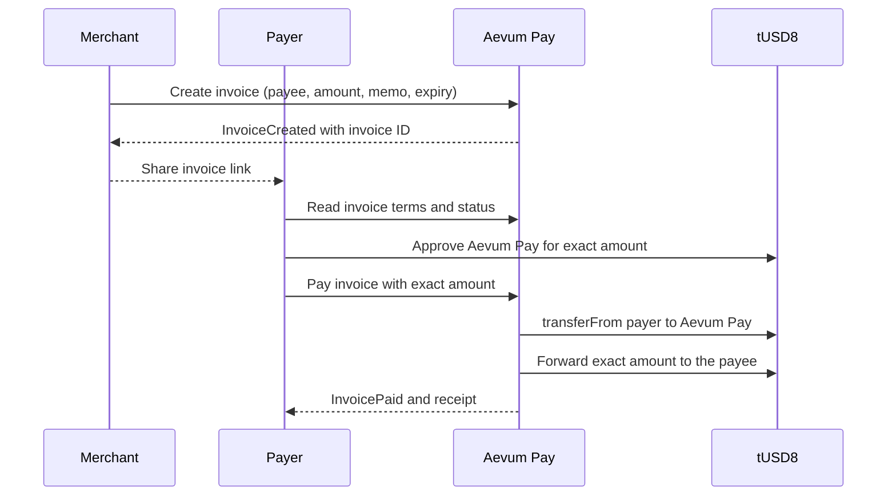

# Aevum Pay

A tUSD8 invoice checkout for [Aevum Builder Challenge #1](https://dorahacks.io/hackathon/qday/detail). A merchant can send a fixed payment request tied to an order, and the payer can confirm who will receive the tokens and verify settlement on-chain. It is designed for small merchants and service providers who need to reconcile stablecoin receipts against orders.

## Run the local demo

With Docker and Compose, run:

```sh
docker compose up --build
```

Open `http://localhost:8080`. The container starts a local Anvil chain, deploys a six-decimal mock tUSD8 token and Aevum Pay, and prints the result of the scripted checkout. The web port binds to loopback on the host. Stop the container to discard the local chain.

If Docker Hub returns HTTP 429 for the official Node image, try `NODE_IMAGE=mirror.gcr.io/library/node:22-bookworm-slim docker compose up --build`.

Without Docker, use Node.js 22 or newer and Foundry (tested with 1.5.1):

```sh
npm ci
forge build
npm run demo:web
```

Open `http://localhost:8080`. Create an invoice as **Merchant**, then use **Copy link**. Open the link, select **Payer**, click **Approve exact amount**, then click **Pay invoice**. The invoice displays **Paid**, the payer address, and the transaction hashes. Invoice #1 is already paid by the startup script. For a rejection example, create and cancel a second request, or use Foundry to test the expiry boundary without waiting.

Local mode starts Anvil with zero generated accounts. Two fixed addresses impersonated by Anvil act as merchant and payer. It uses mock tokens and gas, and resets on restart. For a CLI-only run after `forge build`, use `npm run demo`.

## How payment works



- **Contract.** Solidity 0.8.28, Foundry and OpenZeppelin SafeERC20. The invoice creator is the merchant and can choose a separate payout address. The payee and terms are fixed once created. The cap is 1,000 tUSD8 per invoice. An open invoice can be cancelled only by its creator and ceases to be payable at its expiry block timestamp. A settled invoice records its payer.
- **Settlement.** The contract requires the exact invoice amount, uses a reentrancy guard and checks both transfer balance deltas. A failed pull or forwarding transfer rolls back the token movements and paid status. There is no owner, withdrawal function or upgrade mechanism.
- **Checkout.** Static HTML, CSS and JavaScript using ethers and an injected EIP-1193 wallet for testnet writes. The browser checks deployment bytecode and its immutable token against this release before enabling approvals. It reads invoice state directly from chain, uses the exact token allowance, and links testnet transaction hashes to the explorer. The UI has no key input or secret storage.

For raw reads, use the contract's `getInvoice(id)` entry point. Status values are 0 missing, 1 open, 2 paid, 3 cancelled, and 4 expired. All contract amounts are integer token base units.

```sh
cast call "$AEVUM_PAY_ADDRESS" \
  'getInvoice(uint256)((address,address,uint64,uint256,string,uint8,address))' 1 \
  --rpc-url https://rpc-test.qday.info
```

## Aevum testnet

Verified against public QDay sources on 22 November 2026 HKT. Public RPC calls confirmed the chain ID, the token's `decimals()`, and its `symbol()`.

| Setting | Value | Official source |
| --- | --- | --- |
| Network | QDay Aevum testnet, chain ID `44005` (`0xABE5`) | [QDay testnet guide](https://qday.io/news/aevum-testnet-getting-started) |
| RPC | `https://rpc-test.qday.info` | [Official links and addresses](https://qday.io/official-links) |
| Explorer | `https://explorer-test.qday.info` | [Official links and addresses](https://qday.io/official-links) |
| Gas | tQDAY, 18 decimals | [QDay testnet guide](https://qday.io/news/aevum-testnet-getting-started) |
| tUSD8 | `0x456569838f1d43009A91ebA4263147Afd7233483`, 6 decimals | [Aevum tUSD8 explorer page](https://explorer-test.qday.info/token/0x456569838f1d43009A91ebA4263147Afd7233483) and [QDay challenge page](https://qday.io/builder-challenge) |
| Faucet | `https://faucet.qday.info/en` | [Official links and addresses](https://qday.io/official-links) |
| Verification | Blockscout, `https://explorer-test.qday.info/api` | [QDay testnet guide](https://qday.io/news/aevum-testnet-getting-started) and [explorer verification form](https://explorer-test.qday.info/contract-verification) |

**Aevum Pay deployment address, transaction hash and verified-source link** are pending deployment. Local demo addresses printed by Anvil are for the local chain.

### Deploy and verify with your testnet-only key

1. Run `npm ci` and `forge build`. Fund your own testnet-only deployer and test wallets using the official faucet. The merchant needs tQDAY, and the payer needs tQDAY and tUSD8.
2. In Bash, load your own deployer key without putting it in shell history, then broadcast to chain 44005.

   ```sh
   read -rs -p 'Aevum testnet-only deployer key: ' AEVUM_DEPLOYER_KEY
   printf '\n'
   export AEVUM_DEPLOYER_KEY
   ./scripts/aevum.sh deploy
   unset AEVUM_DEPLOYER_KEY
   ```

3. Copy the deployed Aevum Pay address and deploy transaction hash from Foundry's output or the broadcast receipt. Set `AEVUM_PAY_ADDRESS` to that address and verify from the same checkout.

   ```sh
   ./scripts/aevum.sh verify "$AEVUM_PAY_ADDRESS"
   ```

   The script uses the official Blockscout API with the same compiler settings and encoded tUSD8 constructor argument. Wait for verification and open the printed contract page. The explorer's [Verify & publish contract](https://explorer-test.qday.info/contract-verification) form also accepts Solidity Standard JSON input. Use the same compiler version, optimizer settings, EVM target, and constructor argument.

4. Start the static testnet interface with `npm start`, open `http://localhost:8080`, load the verified address, and connect the merchant wallet. Create a request and share it. In the payer wallet, open the link, review the terms, approve the exact amount, and pay. Confirm **Paid** and open the transaction in the Aevum explorer. Alternately, run `npm run demo:testnet` with the separate merchant and payer signing keys in the environment to perform a 1.25 tUSD8 testnet checkout. The deployment and demo scripts pin the official testnet endpoint and check its chain ID.

### Environment variables

| Variable | Purpose |
| --- | --- |
| `AEVUM_DEPLOYER_KEY` | User-supplied, 0x-prefixed testnet-only signing key. Required by deploy. |
| `AEVUM_PAY_ADDRESS` | User's verified deployment address. Required by the testnet CLI. Pass it positionally to the verify command. |
| `AEVUM_MERCHANT_KEY`, `AEVUM_PAYER_KEY` | User-supplied, 0x-prefixed testnet-only keys for the scripted testnet demo. The browser uses an injected wallet. |
| `WEB_HOST`, `WEB_PORT` | Optional static server bind host and port. Defaults are `127.0.0.1` and `8080`. Compose exposes only the loopback web port. |

Keep keys out of files tracked by Git and unset them when finished. No key is needed for verification, the local CLI, or the local browser demo.

## Testing

```sh
forge build
forge test
forge fmt --check
node scripts/update-runtime.mjs --check
npm run demo
```

Foundry covers creation and events, exact settlement, over/underpayment, expiry, a repeated payment, merchant-only cancellation, insufficient allowance and retry, the cap, input validation, and rollback on inexact forwarding. The Anvil CLI checks the invoice terms and paid state, exact payee and payer balance changes, unchanged contract balance, and consumed allowance. To rebuild the release's runtime fingerprint after a Solidity or build-settings change, run `forge build` followed by `node scripts/update-runtime.mjs` and deploy the corresponding release.

| Check | Local result |
| --- | --- |
| `forge build` | 15 files compiled successfully with solc 0.8.28. |
| `forge test` | 15 passed, 0 failed, 0 skipped. |
| `npm run demo` | 1 create–approve–pay flow passed on Anvil (1.25 mock tUSD8). |
| `WEB_HOST=127.0.0.1 WEB_PORT=8082 npm run demo:web` | 9 Chrome checks passed, 0 failed, including a shared invoice, settlement, cross-tab cancellation and allowance revocation, plus a mobile lookup. |
| `docker compose build` and `docker compose run --rm aevum-pay node scripts/local-demo.mjs` | Image built and 1 create–approve–pay flow passed inside the container. |
| `NODE_IMAGE=mirror.gcr.io/library/node:22-bookworm-slim docker compose up --build --detach` | Final image built, served the checkout, reported chain 31337, and passed the startup payment. Docker Hub returned HTTP 429 during the final rebuild. |

## Limitations and submission

- Invoice memos, addresses, and transfers are public. The app has no accounts database or on-chain search index. Share an invoice link or look up the ID against the deployment.
- tUSD8 allowance is per payer and contract. If approval succeeds and payment fails, expires or is cancelled, revoke the remaining allowance in the UI. Cancelling the invoice prevents settlement immediately but cannot change another user's token allowance.
- The contract expects an exact-transfer ERC-20. Native asset transfers, refunds, partial payments, recurring charges and delegated signing are outside this flow. The cap applies to individual invoices, and the contract has no recovery path for unsolicited direct token transfers.
- The public repository, packaged local prototype, and documentation are the submission materials. Supply Aevum integration evidence after deployment by adding the verified contract link and the create, approve and pay explorer links. Capture the merchant-to-payer sequence and cancelled or expired example for the short demo. Top five teams are invited to a 3–5 minute Demo Day presentation.
- The build window is 16 November through 11 December 2026. Submission closes 11 December at 16:00 HKT (08:00 UTC). Judging runs 12–14 December, and Demo Day is 15 December. [DoraHacks challenge details](https://dorahacks.io/hackathon/qday/detail)
